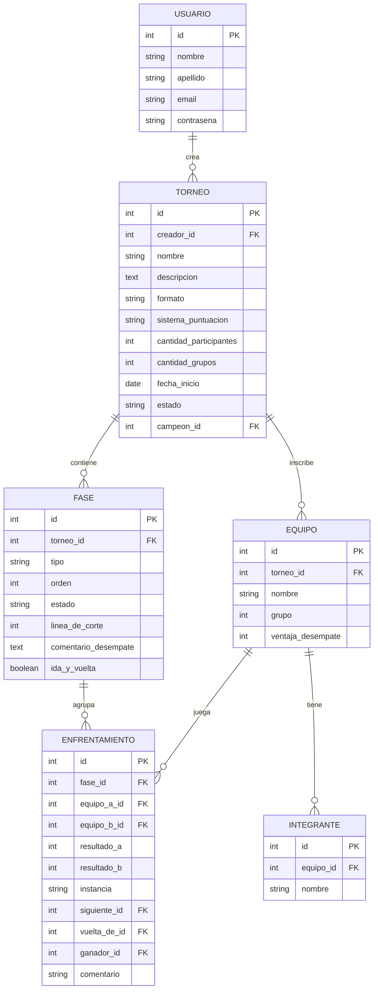

# Estructura de la Base de Datos

**Gestor Universal de Torneos**

Giuliano Scaglioni – Daniela Romero

## Introducción

Este documento resume el modelo de datos definido para el Gestor Universal de Torneos y las decisiones de diseño detrás de cada tabla, resueltas a partir de simular el flujo de distintos formatos de torneo (liga, eliminación simple y doble, grupos + eliminatorias).

## Diagrama entidad-relación



## Tablas

- **Usuario:** organizadores registrados. Cada uno crea y administra sus propios torneos.
- **Torneo:** configuración general del torneo: formato, sistema de puntuación, cantidad de participantes y de grupos, estado del ciclo de vida (borrador / en curso / finalizado). No es editable una vez iniciado.
- **Fase:** cada etapa del torneo (liga, grupos, eliminación). Guarda su propio estado, la línea de corte de clasificación, el comentario del organizador si tuvo que resolver un desempate a mano, y si esa etapa se juega a ida y vuelta (`ida_y_vuelta`).
- **Equipo:** participantes inscriptos en un torneo. Puede representar un equipo de varios integrantes o un jugador individual. Incluye el grupo al que pertenece y el valor de ventaja para desempatar en la tabla de posiciones.
- **Integrante:** nombres de las personas que integran un equipo (opcional; no aplica si el equipo es un único jugador).
- **Enfrentamiento:** cada partido. Vincula dos equipos, guarda el resultado y el ganador, y encadena el fixture con `siguiente_id` (a qué cruce avanza el ganador) y `vuelta_de_id` (si esta fila es la revancha de un cruce de ida y vuelta).

## Diccionario de datos

### 1. Entidad USUARIO

| Atributo | Tipo de dato | Clave / Restricción | Uso en la lógica de negocio |
| --- | --- | --- | --- |
| **id** | INT | PK, Auto-increment | Identificador único del usuario organizador en el sistema. |
| **nombre** | VARCHAR(100) | NOT NULL | Nombre del organizador para personalización de la interfaz y perfil. |
| **apellido** | VARCHAR(100) | NOT NULL | Apellido del organizador. |
| **email** | VARCHAR(150) | UNIQUE, NOT NULL | Credencial única de acceso (login) y canal de contacto/recuperación. |
| **contrasena** | VARCHAR(255) | NOT NULL | Hash encriptado de la contraseña para validación segura de sesión vía JWT. |

### 2. Entidad TORNEO

| Atributo | Tipo de dato | Clave / Restricción | Uso en la lógica de negocio |
| --- | --- | --- | --- |
| **id** | INT | PK, Auto-increment | Identificador único del torneo. Utilizado para la generación de la URL pública de acceso libre a espectadores. |
| **creador_id** | INT | FK (USUARIO.id), NOT NULL | Control de acceso: determina qué organizador posee permisos de edición sobre la competencia. |
| **nombre** | VARCHAR(150) | NOT NULL | Título público del torneo mostrado en encabezados, listas e historial. |
| **descripcion** | TEXT | NULL | Información general, reglas adicionales o aclaraciones informativas dirigidas a espectadores. |
| **formato** | VARCHAR(50) | NOT NULL | Define el algoritmo de generación de fixture y fases (liga_simple, liga_doble, eliminacion_simple, eliminacion_doble, liguilla_eliminacion, grupos_eliminatorias). |
| **sistema_puntuacion** | VARCHAR(50) | NOT NULL | Regla de cómputo de puntos para las tablas de posiciones (ganada_perdida, futbol_clasico, sistema_alternativo). |
| **cantidad_participantes** | INT | NOT NULL | Cantidad total de equipos inscriptos. Valida límites de inscripción y cálculo de brackets (potencias de 2). |
| **cantidad_grupos** | INT | NULL | Número de zonas en torneos con fase de grupos. Debe ser potencia de 2 (ej: 2, 4). |
| **fecha_inicio** | DATE | NULL | Fecha referencial para ordenamiento cronológico en el historial del organizador. |
| **estado** | VARCHAR(20) | NOT NULL, DEFAULT 'borrador' | Estado global del torneo (borrador: editable completo; en_curso: configuración bloqueada, marcadores editables por fase; finalizado: solo lectura). |
| **campeon_id** | INT | FK (EQUIPO.id), NULL | Apuntador al equipo ganador del torneo tras concluir la última fase. Facilita consultas inmediatas de cuadros de honor. |

### 3. Entidad FASE

| Atributo | Tipo de dato | Clave / Restricción | Uso en la lógica de negocio |
| --- | --- | --- | --- |
| **id** | INT | PK, Auto-increment | Identificador único de la fase competitiva. |
| **torneo_id** | INT | FK (TORNEO.id), NOT NULL | Vincula la fase con su torneo contenedor. La eliminación de un torneo remueve sus fases en cascada. |
| **tipo** | VARCHAR(50) | NOT NULL | Determina la vista y el algoritmo de cálculo (liga, grupos, eliminacion). |
| **orden** | INT | NOT NULL | Secuencia cronológica de la fase (1, 2, ...). Controla el flujo de avance del torneo. |
| **estado** | VARCHAR(20) | NOT NULL, DEFAULT 'activa' | activa: permite carga y corrección de marcadores. cerrada: bloquea de forma inmutable los resultados de esa fase para no alterar la fase siguiente. |
| **linea_de_corte** | INT | NULL | Configuración que establece cuántos equipos clasifican por grupo o tabla hacia la siguiente instancia (ej: "primeros 2 de cada grupo"). |
| **ida_y_vuelta** | BOOLEAN | NOT NULL, DEFAULT false | Determina si las llaves eliminatorias de esta fase duplican enfrentamientos en modalidad revancha. |
| **comentario_desempate** | TEXT | NULL | Registro de auditoría donde el organizador documenta el criterio utilizado en la resolución manual de empates en la línea de corte. |

### 4. Entidad EQUIPO

| Atributo | Tipo de dato | Clave / Restricción | Uso en la lógica de negocio |
| --- | --- | --- | --- |
| **id** | INT | PK, Auto-increment | Identificador único del equipo dentro del sistema. |
| **torneo_id** | INT | FK (TORNEO.id), NOT NULL | Asocia al equipo con un torneo específico. |
| **nombre** | VARCHAR(100) | NOT NULL | Denominación del equipo o participante visualizada en fixtures, brackets y tablas de posiciones. |
| **grupo** | INT | NULL | Número de zona o grupo asignado (1, 2, etc.) para filtrar y calcular tablas de posiciones independientes por zona. |
| **ventaja_desempate** | INT | NOT NULL, DEFAULT 0 | Puntuación numérica o criterio asignado manualmente por el organizador para resolver empates relevantes en puntos y definir el orden de clasificación. |

### 5. Entidad INTEGRANTE

| Atributo | Tipo de dato | Clave / Restricción | Uso en la lógica de negocio |
| --- | --- | --- | --- |
| **id** | INT | PK, Auto-increment | Identificador único del integrante. |
| **equipo_id** | INT | FK (EQUIPO.id), NOT NULL | Asocia la persona al equipo correspondiente. Eliminación en cascada si se borra el equipo. |
| **nombre** | VARCHAR(100) | NOT NULL | Nombre y/o apellido del jugador/integrante mostrado en la lista detallada del equipo. |

### 6. Entidad ENFRENTAMIENTO

| Atributo | Tipo de dato | Clave / Restricción | Uso en la lógica de negocio |
| --- | --- | --- | --- |
| **id** | INT | PK, Auto-increment | Identificador único del partido o cruce. |
| **fase_id** | INT | FK (FASE.id), NOT NULL | Asocia el partido a una fase activa o cerrada. |
| **equipo_a_id** | INT | FK (EQUIPO.id), NULL | Primer competidor (Local). Es NULL en rondas eliminatorias futuras hasta que avance el clasificado. |
| **equipo_b_id** | INT | FK (EQUIPO.id), NULL | Segundo competidor (Visitante). Es NULL en rondas futuras o en caso de Byes (Pase Libre). |
| **resultado_a** | INT | NULL | Puntos/goles convertidos por el Equipo A. Si es NULL, el partido no ha sido disputado. |
| **resultado_b** | INT | NULL | Puntos/goles convertidos por el Equipo B. Si es NULL, el partido no ha sido disputado. |
| **instancia** | VARCHAR(50) | NULL | Etapa dentro de la fase (fecha_1, octavos, cuartos, semifinal, final) para renderizar y agrupar visualmente la grilla o el bracket. |
| **siguiente_id** | INT | FK (ENFRENTAMIENTO.id), NULL | Apuntador al partido de la siguiente ronda. Al cargar un ganador, el sistema lo promueve automáticamente al slot vacante de este siguiente_id. |
| **vuelta_de_id** | INT | FK (ENFRENTAMIENTO.id), NULL | En fases a ida y vuelta, este campo se completa en el partido de revancha apuntando a la ida. Concentra la definición global de la serie. |
| **ganador_id** | INT | FK (EQUIPO.id), NULL | Determina qué equipo avanza o gana el cruce. |
| **comentario** | VARCHAR(255) | NULL | Aclaración sobre el resultado cargado por el organizador (ej: *"Avanza Equipo A por ventaja deportiva"* o *"Definido por penales 5-4"*). |

## Decisiones de diseño

- PJ, PG, PE, PP y Puntos de la tabla de posiciones no se guardan: se calculan agregando Enfrentamiento por equipo y por fase.
- El grupo de un equipo es una columna simple (`grupo` en Equipo) y no una tabla aparte, porque un equipo pertenece a un solo grupo por torneo.
- Los empates se resuelven a mano por el organizador: `ventaja_desempate` ordena la tabla de posiciones, y `comentario_desempate` en Fase deja constancia de cómo se resolvió.
- Si una fase de eliminación se juega a ida y vuelta es una configuración de esa fase (`ida_y_vuelta`, booleano en Fase), definida al crear el torneo y bloqueada junto con el resto de la configuración.
- La cantidad de grupos y la cantidad de clasificados por grupo deben ser potencias de 2, para que el total de clasificados a playoffs también lo sea y no haya que resolver un bye entre grupos distintos.
- El emparejamiento entre grupos sigue la regla grupo i vs. grupo i + (cantidad de grupos / 2); dentro de cada par se cruza por posición inversa (el mejor ubicado contra el peor clasificado del grupo opuesto, y así hacia el medio).
- La configuración del torneo se bloquea al iniciar. Cada fase se confirma antes de avanzar a la siguiente, y en ese momento sus resultados quedan bloqueados para edición.

## Especificación de formatos de competencia

Para garantizar una correcta interpretación de la lógica del sistema por parte del equipo de desarrollo, docentes y usuarios organizadores, se definen a continuación los formatos de competencia soportados por la plataforma y sus reglas de implementación.

### 1. Liga Simple y Liga Doble

- **Descripción:** todos los participantes se enfrentan entre sí en un sistema de ronda única (liga simple) o ida y vuelta (liga doble).
- **Determinación del fixture:** se aplica el algoritmo de emparejamiento Round-Robin (sistema de todos contra todos). Para N participantes:
  - Liga Simple: se generan N × (N - 1) / 2 partidos distribuidos en N - 1 fechas (si N es par) o N fechas (si N es impar, incluyendo fechas libres).
  - Liga Doble: se generan N × (N - 1) partidos distribuidos en 2 × (N - 1) fechas.
- **Cálculo de posiciones y tratamiento de `ganador_id`:** no existen columnas de puntos ni partidos guardados en la base de datos. La tabla de posiciones se calcula dinámicamente evaluando `resultado_a`, `resultado_b` y `ganador_id` de la tabla ENFRENTAMIENTO:
  - Si `ganador_id` posee el ID del equipo, se le otorgan los puntos correspondientes a la victoria (3 o 2 puntos según el sistema de puntuación).
  - Si `ganador_id` es NULL (habiéndose cargado marcadores), el sistema interpreta empate y otorga 1 punto a cada participante.
- **Identificación de fechas:** el atributo `instancia` en la tabla ENFRENTAMIENTO se auto-completa secuencialmente con los valores 'fecha_1', 'fecha_2', ..., 'fecha_N'.

### 2. Eliminación Simple (Playoffs Directos)

- **Descripción:** estructura en árbol (bracket) de partidos a eliminación directa. El equipo perdedor queda automáticamente fuera de la competencia.
- **Tratamiento de `ganador_id`:** en este formato no se admiten empates como resultado final. El campo `ganador_id` nunca puede quedar en NULL al registrar un resultado disputado (si empatan en el tiempo reglamentario, el organizador resuelve manualmente el método de desempate). El equipo indicado en `ganador_id` es el que se promueve al partido apuntado por `siguiente_id`.
- **Tamaño del bracket y gestión de Byes:**
  - El tamaño base del bracket siempre se ajusta a la potencia de 2 igual o inmediatamente superior a la cantidad de participantes (2^k. Ej.: 4, 8, 16, 32).
  - Si la cantidad de equipos inscriptos no es potencia de 2, la diferencia representa la cantidad de Byes (pases libres) asignados en la primera ronda.
  - Asignación de Bye: un partido con Bye se crea asignando únicamente a `equipo_a_id`, dejando `equipo_b_id = NULL`. Automáticamente se asigna `ganador_id = equipo_a_id` y el equipo es promovido al partido correspondiente de la siguiente ronda a través de `siguiente_id`.
- **Encadenamiento de cruces:** todos los enfrentamientos de todas las rondas se crean de forma anticipada al iniciar la fase. Los cruces de rondas futuras se vinculan mediante la clave foránea `siguiente_id`.

### 3. Eliminación Doble (Partidos a Ida y Vuelta)

- **Descripción:** similar a la eliminación simple, pero cada serie entre dos equipos consta de dos partidos (ida y vuelta).
- **Mecanismo de definición y roles de `ganador_id`:**
  - Para cada cruce se generan dos filas en ENFRENTAMIENTO.
  - En ambos partidos se registra `resultado_a` y `resultado_b`. Si hay un ganador en este encuentro puntual, su `ganador_id` se completa con dicho ID (o NULL si el partido finalizó en empate).
  - Partido de vuelta: posee la clave foránea `vuelta_de_id` apuntando al id del partido de ida. El campo `siguiente_id` se asocia al partido de ida de la siguiente serie.
  - El sistema resuelve el ganador de la serie de manera automática mediante el cálculo de los puntos generados en ambos partidos. Si existe un empate, este se gestiona manualmente por el organizador.

### 4. Liguilla + Playoffs (Formato Mixto A)

- **Descripción:** combina una primera fase de todos contra todos (liga) con una segunda fase de eliminación directa entre los mejores clasificados.
- **Fases del torneo:**
  - Fase 1 (`orden = 1`, `tipo = 'liga'`): se disputa la fase regular. Se define una `linea_de_corte` (ej.: "Clasifican los primeros 4").
  - Fase 2 (`orden = 2`, `tipo = 'eliminacion'`): se genera recién cuando la Fase 1 es cerrada por el organizador.
- **Seeding dinámico por posición:** los enfrentamientos del bracket eliminatorio no se sortean; se arman en base a la tabla de posiciones de la Fase 1 (ej.: 1° vs 4°, 2° vs 3°). Si el número de clasificados no es potencia de 2, el/los mejor(es) posicionado(s) reciben el Bye como beneficio por su desempeño.

### 5. Fase de Grupos + Eliminatorias (Formato Mixto B)

- **Descripción:** se divide a los equipos en zonas independientes. Los clasificados de cada grupo avanzan a un cuadro eliminatorio final.
- **Fases del torneo:**
  - Fase 1 (`orden = 1`, `tipo = 'grupos'`): los equipos tienen asignado el atributo `EQUIPO.grupo` (1, 2, ... G). La cantidad de grupos G debe ser siempre potencia de 2 (2, 4, 8).
  - Fase 2 (`orden = 2`, `tipo = 'eliminacion'`): bracket de playoffs general.
- **Emparejamiento cruzado entre grupos:** el bracket de Fase 2 cruza los clasificados de distintas zonas para evitar que equipos del mismo grupo reincidan en primera ronda.
  - Regla de cruce: Grupo i vs. Grupo i + G/2, invirtiendo posiciones (1° del Grupo A vs. 2° del Grupo B; 1° del Grupo B vs. 2° del Grupo A).

## Casos de uso

A continuación se recorre, para cada formato soportado, qué filas se crean o actualizan en la base de datos.

### Caso de uso: creación y desarrollo de una Liga Simple

**Escenario:** liga barrial de fútbol 5 con 10 equipos inscriptos.

**Flujo paso a paso:**

1. **Petición del organizador (creación):**
   - El usuario crea el torneo completando:
     - `nombre`: "Liga Nocturna F5"
     - `formato`: "liga_simple"
     - `sistema_puntuacion`: "futbol_clasico" (3 pts victoria, 1 pt empate, 0 pt derrota)
     - `cantidad_participantes`: 10
2. **Inscripción de equipos:**
   - El organizador registra los 10 nombres de los equipos en la tabla EQUIPO asociados a `torneo_id`.
3. **Inicio de competencia y generación de fixture:**
   - El organizador presiona "Iniciar Torneo".
   - El sistema cambia `TORNEO.estado = 'en_curso'`.
   - Se crea la primera fase: `FASE (torneo_id, tipo = 'liga', orden = 1, estado = 'activa')`.
   - Se ejecuta el algoritmo Round-Robin: para 10 equipos se generan C(10,2) = 45 enfrentamientos en 9 fechas.
   - Inserción masiva en ENFRENTAMIENTO:
     - Partidos de Fecha 1: `instancia = 'fecha_1'` (5 registros).
     - Partidos de Fecha 2: `instancia = 'fecha_2'` (5 registros), y así hasta `fecha_9`.
     - `equipo_a_id` y `equipo_b_id` quedan asignados; `resultado_a`, `resultado_b` y `ganador_id` nacen como NULL.
4. **Carga de marcador:**
   - Caso A: gana Equipo 1 a Equipo 2 (3 - 1):

     ```sql
     UPDATE ENFRENTAMIENTO
     SET resultado_a = 3, resultado_b = 1, ganador_id = 1
     WHERE id = 101;
     ```

   - Caso B: empatan Equipo 3 y Equipo 4 (2 - 2):

     ```sql
     UPDATE ENFRENTAMIENTO
     SET resultado_a = 2, resultado_b = 2, ganador_id = NULL
     WHERE id = 102;
     ```

5. **Consulta de tabla de posiciones:**
   - La API ejecuta una consulta con CASE / SUM evaluando si `ganador_id = equipo_id` (+3 pts) o si `ganador_id` IS NULL (+1 pt a cada uno), agrupando los partidos finalizados de la `FASE.id`.

### Caso de uso: creación y desarrollo de una Liga Doble

**Escenario:** liga barrial de fútbol 5 con 10 equipos inscriptos.

El proceso de creación es el mismo que el de la liga simple, pero se elige `formato: "liga_doble"`. Se generan en consecuencia 90 filas. Cada par juega dos veces, con `equipo_a_id` y `equipo_b_id` invertidos entre ambas filas (el local de una es visitante en la otra). Las dos filas son independientes, sin ningún campo que las vincule. Cada resultado cargado actualiza una sola fila y suma de forma independiente a la tabla de posiciones, calculada por agregación sobre ENFRENTAMIENTO.

### Caso de uso: torneo relámpago a eliminación simple con Byes

**Escenario:** torneo de Truco de 7 parejas disputado en una tarde.

**Flujo operativo paso a paso:**

1. **Parametrización del torneo:**
   - El usuario crea el torneo completando:
     - `formato`: "eliminacion_simple"
     - `sistema_puntuacion`: "ganada_perdida"
     - `cantidad_participantes`: 7
     - `TORNEO.estado`: 'en_curso'.
2. **Cálculo de bracket y generación de estructura:**
   - La potencia de 2 superior más cercana a 7 es 8.
   - Cantidad de Byes: 8 - 7 = 1.
   - Se crea la fase: `FASE (tipo = 'eliminacion', orden = 1, ida_y_vuelta = false)`.
   - Se generan anticipadamente los 7 partidos del cuadro eliminatorio:
     - 4 partidos de Cuartos de Final (`instancia = 'cuartos'`): IDs 1, 2, 3, 4. A estos partidos se les asignan equipos.
     - 2 partidos de Semifinal (`instancia = 'semifinal'`): IDs 5 (`siguiente_id` de 1 y 2) y 6 (`siguiente_id` de 3 y 4). Estos y los demás partidos de rondas futuras adquieren los ids de equipos a medida que hay ganadores.
     - 1 partido de Final (`instancia = 'final'`): ID 7 (`siguiente_id` de 5 y 6).
3. **Asignación del Bye por sorteo:**
   - El sistema sortea aleatoriamente qué equipo obtiene el Bye (ej.: Equipo 7).
   - El Partido 4 de Cuartos se configura como Bye:
     - `equipo_a_id = 7`
     - `equipo_b_id = NULL`
     - `ganador_id = 7`
   - **Propagación automática:** el sistema inserta inmediatamente al Equipo 7 en el Partido 6 (Semifinal) en el slot `equipo_b_id`.
4. **Avance de ganadores:**
   - Se disputa el Partido 1 de Cuartos: Equipo 1 vs. Equipo 2. Gana Equipo 1 (resultado 30-18).
   - El sistema actualiza ENFRENTAMIENTO ID 1 con `ganador_id = 1`.
   - El sistema lee `siguiente_id = 5` y actualiza el Partido 5 (Semifinal) asignando `equipo_a_id = 1`.

### Caso de uso: eliminatoria directa a ida y vuelta con desempate

**Escenario:** llave final de un torneo de FIFA disputada a dos partidos.

**Flujo operativo paso a paso:**

1. **Parametrización del torneo:**
   - El usuario crea el torneo completando:
     - `formato`: "eliminacion_doble"
     - `sistema_puntuacion`: "ganada_perdida"
     - `cantidad_participantes`: 7
     - `TORNEO.estado`: 'en_curso'.
2. **Configuración de la fase:**
   - El usuario crea el torneo con `Fase.ida_y_vuelta = true`.
3. **Generación del cruce (ida y vuelta):**
   - Se insertan dos filas en ENFRENTAMIENTO:
     - Fila 201 (Ida): `equipo_a_id = 10`, `equipo_b_id = 20`, `instancia = 'semifinal_ida'`.
     - Fila 202 (Vuelta): `equipo_a_id = 20`, `equipo_b_id = 10`, `instancia = 'semifinal_vuelta'`, `vuelta_de_id = 201`, `siguiente_id = 301` (Final).
4. **Carga del partido de ida:**
   - Resultado: Equipo 10 (Local) 2 vs. Equipo 20 (Visitante) 1.
   - Se actualiza la Fila 201: `resultado_a = 2`, `resultado_b = 1`, `ganador_id = 10`.
5. **Carga del partido de vuelta y definición de serie:**
   - Resultado en los 90 minutos: Equipo 20 (Local) 1 vs. Equipo 10 (Visitante) 0.
   - Marcador global acumulado: 2 - 2 (empate).
   - El organizador es avisado del empate y debe resolver quién es el ganador global de la serie, y tiene la posibilidad de dejar un comentario para explicar cómo se resolvió.
   - El organizador ingresa en el formulario del Partido de Vuelta:
     - `resultado_a = 1`
     - `resultado_b = 0`
     - `ganador_id = 10` (el ganador del partido, no de la serie).
     - `comentario = "Empate global 2-2. Clasifica Equipo 20 por diferencia de goles a favor."`
   - El desempate no se puede resolver de manera automática, por lo que se realiza de modo manual. El sistema actualiza la Fila 202 con los resultados del enfrentamiento (ganador del partido: Equipo 10), y promueve al Equipo 20 (ganador de la serie) a la Final (ENFRENTAMIENTO ID 301).
6. **Aclaraciones:**
   - El bye, si corresponde, es una única fila sin vuelta, igual que en eliminación simple.

### Caso de uso: formato mixto, Liguilla + Playoffs con resolución de empate

**Escenario:** torneo de FIFA de 7 jugadores: todos contra todos y clasifican los 4 mejores a Playoffs.

**Flujo operativo paso a paso:**

1. **Inicio en Fase 1 (Liguilla):**
   - El usuario crea el torneo completando `formato: "liguilla_eliminacion"`.
   - `FASE 1: tipo = 'liga', linea_de_corte = 4`. Se disputan los 21 partidos de la rueda.
2. **Finalización de Fase 1 y detección de empate relevante:**
   - Se completa el último partido. La tabla muestra:
     - 1° Puesto: Jugador A (15 pts)
     - 2° Puesto: Jugador B (12 pts)
     - 3° Puesto: Jugador C (10 pts)
     - 4° Puesto (empate en la línea de corte): Jugador D (7 pts, +2 de diferencia de gol) y Jugador E (7 pts, +2 de diferencia de gol).
   - Los puestos 4° y 5° determinan quién pasa a semifinales y quién queda eliminado.
   - El sistema detecta que es un **empate relevante en la línea de corte** e impide cerrar la fase automáticamente.
3. **Resolución manual del desempate:**
   - La interfaz le solicita al organizador definir el orden entre Jugador D y Jugador E.
   - El organizador otorga la ventaja al Jugador D por criterio de "resultado entre sí".
   - Actualización en la base de datos:

     ```sql
     UPDATE EQUIPO SET ventaja_desempate = 1 WHERE id = ID_JUGADOR_D;

     UPDATE FASE SET comentario_desempate = 'Jugador D clasifica 4to por haber ganado el enfrentamiento directo contra Jugador E en la Fecha 3.' WHERE id = FASE_1_ID;
     ```

4. **Cierre de Fase 1 y generación de Fase 2 (Playoffs):**
   - El organizador confirma el avance a la siguiente fase.
   - Se actualiza `FASE_1.estado = 'cerrada'` (se bloquean todos los marcadores de la liguilla).
   - Se crea automáticamente la `FASE 2: tipo = 'eliminacion', orden = 2`.
   - Se arman los cruces de Semifinales según el seeding de la Fase 1:
     - Semifinal 1: 1° Puesto (Jugador A) vs. 4° Puesto (Jugador D).
     - Semifinal 2: 2° Puesto (Jugador B) vs. 3° Puesto (Jugador C).

### Caso de uso: Fase de Grupos + Eliminatorias con emparejamiento cruzado

**Escenario:** torneo barrial de vóley con 8 equipos divididos en 2 grupos de 4 equipos cada uno.

**Flujo operativo paso a paso:**

1. **Configuración inicial:**
   - Torneo: `formato = 'grupos_eliminatorias'`, `cantidad_participantes = 8`, `cantidad_grupos = 2`.
   - En la tabla EQUIPO, 4 equipos reciben `grupo = 1` (Grupo A) y 4 equipos reciben `grupo = 2` (Grupo B).
2. **Fase 1 (fase de zonas):**
   - `FASE 1: tipo = 'grupos', orden = 1, linea_de_corte = 2`.
   - Se generan 12 partidos (6 para el Grupo A, 6 para el Grupo B).
   - La vista pública muestra dos tablas de posiciones independientes filtradas por `EQUIPO.grupo`.
3. **Cierre de grupos y generación de playoffs con cruce inter-grupo:**
   - Una vez completados los 12 partidos, el organizador confirma el cierre de la Fase 1.
   - Se clasifican:
     - Grupo A: 1°A (Equipo Redes) y 2°A (Equipo Malla).
     - Grupo B: 1°B (Equipo Remate) y 2°B (Equipo Bloqueo).
   - Se crea la `FASE 2: tipo = 'eliminacion', orden = 2`.
   - El sistema aplica la regla de emparejamiento cruzado:
     - Semifinal 1: 1°A (Equipo Redes) vs. 2°B (Equipo Bloqueo).
     - Semifinal 2: 1°B (Equipo Remate) vs. 2°A (Equipo Malla).
   - Los ganadores de cada semifinal quedan enlazados mediante `siguiente_id` hacia el enfrentamiento de la Gran Final.
